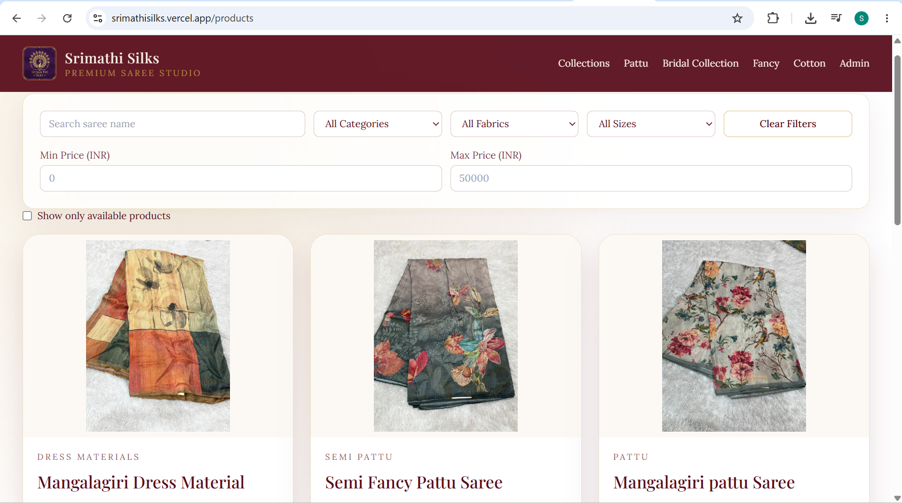
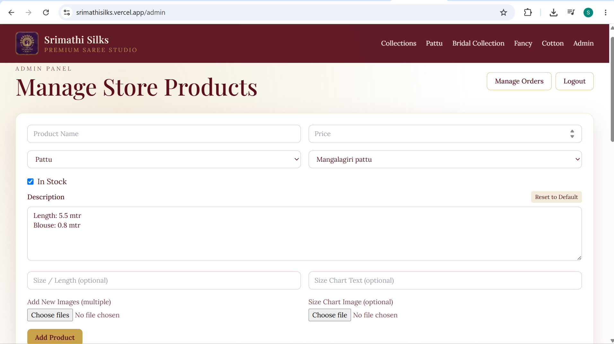

# GV Sarees

     

> Independent GV Sarees project. Configure a separate Firebase project before local development or deployment.

## Short Project Description

GV Sarees is a modern e-commerce and catalog experience for a premium saree boutique. The application combines a polished storefront, product discovery tools, WhatsApp-based enquiry flow, Firebase-backed admin controls, and serverless media and payment integrations to help the business manage inventory and orders efficiently.

## Table of Contents

- [Features](#features-)
- [Screenshots](#screenshots-)
- [Tech Stack](#tech-stack-)
- [Project Architecture](#project-architecture-)
- [Folder Structure](#folder-structure-)
- [Installation](#installation-)
- [Environment Variables](#environment-variables-)
- [Running Locally](#running-locally-)
- [Build for Production](#build-for-production-)
- [Deployment Instructions](#deployment-instructions-)
- [API Endpoints](#api-endpoints-)
- [Authentication Flow](#authentication-flow-)
- [Database Schema Overview](#database-schema-overview-)
- [Admin Features](#admin-features-)
- [User Features](#user-features-)
- [Performance Optimizations](#performance-optimizations-)
- [Security Features](#security-features-)
- [Future Enhancements](#future-enhancements-)
- [Known Limitations](#known-limitations-)
- [Contributing Guidelines](#contributing-guidelines-)
- [License](#license-)
- [Author](#author-)

## Features ✨

- 🛍️ Elegant product catalog with category, fabric, and price-based filtering
- 📱 WhatsApp-driven enquiry flow for quick customer conversion
- 🧑‍💼 Secure admin dashboard to create, edit, and delete products
- 📦 Order management with payment and fulfillment status tracking
- 🖼️ Image uploads and proxying through Telegram-backed serverless endpoints
- 💳 Razorpay checkout is intentionally disabled until reservation-linked payment verification is complete
- 🔍 Product detail pages with gallery-style browsing and size-chart support
- 📱 Responsive UI designed for mobile and desktop experiences
- ⚡ Performance-conscious rendering with lazy loading and skeleton states

## Screenshots 📸

> Screenshots will be added here as the app evolves.






## Tech Stack 🛠️

| Layer | Technologies |
| --- | --- |
| Frontend | React 19, Vite, React Router, Tailwind CSS, Framer Motion, Lucide Icons |
| State & Data | Firebase Authentication, Firestore, React hooks |
| Backend/API | Node.js serverless functions on Vercel, Zod validation, rate limiting |
| Media | Telegram Bot API, Sharp, Multer |
| Payments | Razorpay SDK |
| Tooling | ESLint, PostCSS, Autoprefixer |

### Major Dependencies

- React, React DOM, React Router DOM
- Firebase, Firebase Admin
- Axios
- Razorpay
- Zod
- Framer Motion
- Lucide React
- Multer
- Sharp
- Form Data
- CLSX

## Project Architecture 🧱

The application follows a modular architecture:

1. The React/Vite frontend serves the storefront and admin dashboard.
2. Firebase handles authentication and Firestore persistence for products and orders.
3. Vercel serverless API routes manage reservations, inventory/admin actions, image uploads, and Telegram-backed media proxying.
4. Admin actions are protected by Firebase ID tokens verified by the server.
5. Customer enquiries are stored as orders and routed to WhatsApp through the storefront flow.

```text
User Browser
  └─ React + Vite frontend
       ├─ Firebase Auth + Firestore
       ├─ WhatsApp enquiry flow
       └─ Vercel serverless APIs
            ├─ Telegram image upload/proxy
            ├─ Reservation and inventory APIs
            └─ Admin verification + rate limiting
```

## Folder Structure 🌳

```text
GV_SAREES/
├── api/
│   ├── _lib/
│   ├── image/
│   ├── razorpay/
│   ├── delete-telegram-media.js
│   └── upload-image.js
├── public/
├── scripts/
├── server/
│   ├── firebaseAdmin.js
│   ├── http.js
│   ├── rateLimit.js
│   ├── validation.js
│   └── verifyAdmin.js
├── src/
│   ├── assets/
│   ├── components/
│   ├── config/
│   ├── context/
│   ├── hooks/
│   ├── pages/
│   ├── scripts/
│   ├── services/
│   └── utils/
├── package.json
├── vercel.json
└── vite.config.js
```

## Installation ⚙️

```bash
git clone <your-gv-sarees-repository-url>
cd GV_SAREES
npm install
```

## Environment Variables 🌐

Copy `.env.example` to `.env` in the project root for local development. Use only credentials from the independent GV Sarees services. Never copy credentials from the original Srimathi Silks project.

| Variable | Required | Description |
| --- | --- | --- |
| `VITE_FIREBASE_API_KEY` | Yes | Firebase client API key |
| `VITE_FIREBASE_AUTH_DOMAIN` | Yes | Firebase auth domain |
| `VITE_FIREBASE_PROJECT_ID` | Yes | Firebase project ID |
| `VITE_FIREBASE_STORAGE_BUCKET` | Yes | Firebase storage bucket |
| `VITE_FIREBASE_MESSAGING_SENDER_ID` | Yes | Firebase messaging sender ID |
| `VITE_FIREBASE_APP_ID` | Yes | Firebase app ID |
| `VITE_ADMIN_EMAILS` | Yes | Comma-separated admin emails allowed to access the dashboard |
| `VITE_IMAGE_UPLOAD_ENDPOINT` | Optional | Override for image upload API endpoint |
| `VITE_API_BASE_URL` | Optional | Base URL used for image proxying |
| `VITE_RAZORPAY_CREATE_ORDER_URL` | Not used | Razorpay order creation is disabled; the endpoint returns HTTP 410 |
| `RAZORPAY_KEY_ID` | Not currently used | Razorpay checkout is disabled until a complete verified payment lifecycle exists |
| `RAZORPAY_KEY_SECRET` | Not currently used | Server-only; do not enable payment endpoints before verification and webhook support |
| `TELEGRAM_BOT_TOKEN` | Yes for media uploads | Telegram bot token used for image uploads and proxying |
| `TELEGRAM_CHANNEL_ID` | Yes for media uploads | Telegram channel or chat ID |
| `RESERVATION_TOKEN_SECRET` | Yes for reservations | Server-only random secret (at least 32 bytes) used to generate reservation cancellation capabilities |
| `CRON_SECRET` | Yes for reservation expiry | Server-only Vercel Cron bearer secret; generate with `openssl rand -hex 32` and configure in Vercel project environment variables |
| `FIREBASE_SERVICE_ACCOUNT_JSON` | Alternative | Full Firebase Admin service account JSON |
| `FIREBASE_CLIENT_EMAIL` | Alternative | Firebase admin client email |
| `FIREBASE_PRIVATE_KEY` | Alternative | Firebase admin private key |
| `FIREBASE_PROJECT_ID` | Alternative | Firebase admin project ID |
| `VITE_NGROK_HOST` | Optional | Hostname allowed for local tunnel testing |
| `FIREBASE_SERVICE_ACCOUNT_FILE` | Migration only | Path to a local Admin SDK service-account JSON file |
| `GCLOUD_PROJECT` | Migration fallback | Google Cloud project ID used by the migration script |

<details>
<summary>Example environment file</summary>

```env
# Browser-safe Firebase Web app configuration
VITE_FIREBASE_API_KEY=your_key
VITE_FIREBASE_AUTH_DOMAIN=your-project.firebaseapp.com
VITE_FIREBASE_PROJECT_ID=your-project
VITE_FIREBASE_STORAGE_BUCKET=your-project.firebasestorage.app
VITE_FIREBASE_MESSAGING_SENDER_ID=123456789
VITE_FIREBASE_APP_ID=1:123456789:web:abc123
VITE_ADMIN_EMAILS=admin@example.com

# Server-only values
FIREBASE_SERVICE_ACCOUNT_JSON=
# Or use FIREBASE_CLIENT_EMAIL, FIREBASE_PRIVATE_KEY, and FIREBASE_PROJECT_ID.
RESERVATION_TOKEN_SECRET=
CRON_SECRET=
TELEGRAM_BOT_TOKEN=xxx
TELEGRAM_CHANNEL_ID=xxx
```

</details>

### Firebase setup for GV Sarees

1. Create a new Firebase project specifically for GV Sarees. Do not reuse the original Srimathi Silks project.
2. Register a Web app in the new project and copy its six configuration values into the `VITE_FIREBASE_*` variables.
3. Enable Email/Password sign-in in Firebase Authentication.
4. Create the initial admin user in Firebase Authentication. Add its exact Firebase UID to the `admins/{uid}` collection using a trusted Firebase Admin SDK process, with `{ "isAdmin": true }`. `VITE_ADMIN_EMAILS` is only a browser-side navigation allow-list; it does not grant API or Firestore access.
5. Create the Firestore database in the new project. The application uses `products`, `orders`, and `admins` collections.
6. Create a Firebase Admin service account for server-side token verification. Prefer `FIREBASE_SERVICE_ACCOUNT_JSON` in local/server secret storage, or use the separate `FIREBASE_CLIENT_EMAIL`, `FIREBASE_PRIVATE_KEY`, and `FIREBASE_PROJECT_ID` variables.
7. Keep all service-account fields server-only. Never prefix them with `VITE_`, import them from `src/`, commit them, or paste them into browser-visible configuration.
8. Review and deploy `firestore.rules` only after the new project and initial admin bootstrap have been verified. This project does not deploy rules automatically.

The client uses Firebase Authentication and Firestore through [src/services/firebase.js](./src/services/firebase.js). API routes verify Firebase ID tokens and require an `admins/{uid}` document with `isAdmin: true`; Firestore rules use the same UID-document policy. To add an administrator, create their Firebase Auth account and add their UID record with a trusted Admin SDK process. To revoke access, delete that UID record or set `isAdmin` to false. Never create admin records from browser code.

The current rules are project-independent and do not contain a Firebase project ID. Before first use, review these intentional access choices:

- Product documents are publicly readable.
- WhatsApp enquiries are created only through the validated server-side reservation API. Direct Firestore order writes are denied.
- Product creation/content edits and order reads require an authenticated admin document. Product inventory changes and order lifecycle changes are routed through server APIs.
- `admins` documents cannot be written through the client, so the first `admins/{uid}` document must be created through a trusted, separately approved bootstrap process.

Do not run the migration script with `--apply` until the target Firebase project, collections, rules, and backups have been explicitly confirmed.

### Inventory migration

Legacy products without stock data default to zero available stock. Before enabling reservations, prepare a JSON file mapping each product document ID to the physically confirmed stock count, for example:

```json
{
  "firestoreProductDocumentId": 5
}
```

Run `npm run migrate:inventory -- --input stock-confirmations.json` first. This is a dry run and does not write products. After reviewing the quantities and backing up the target database, apply with `npm run migrate:inventory -- --input stock-confirmations.json --apply --confirm-stock`. Existing reserved quantities are preserved and a migration is rejected if the confirmed physical quantity is below the reserved amount. Never run against production without an approved stock count and backup.

### Telegram image URL audit

Run `node scripts/auditTelegramImageUrls.js` from an environment where Firebase Admin is already configured through process environment variables or Application Default Credentials. The script reads only `products` and reports counts plus affected document IDs and image field paths; it does not print URLs or credentials and performs no writes. It does not load environment files.

### Reservation secrets and rate limits

Set `RESERVATION_TOKEN_SECRET` and `CRON_SECRET` as server-only Vercel environment variables (Production/Preview as applicable). Generate each independently with a cryptographically secure generator such as `openssl rand -hex 32`; do not commit actual values. Rotating `RESERVATION_TOKEN_SECRET` invalidates outstanding customer cancellation tokens.

Reservation creation and cancellation currently use the repository's in-memory rate limiter. Its counters are per serverless instance and are not globally distributed. No Redis/Upstash or other distributed limiter is configured in this project. A distributed limiter requires selecting and configuring a supported shared backend before claiming global rate limits.

Razorpay order creation returns HTTP 410 while a reservation-linked checkout, server-side signature verification, payment webhooks, and delayed-payment handling remain unimplemented.

## Running Locally ▶️

```bash
npm run dev
```

Then open http://localhost:5173.

## Build for Production 🏗️

```bash
npm run build
```

The production build output is generated in the `dist/` directory.

## Deployment Instructions 🚀

This project is configured for Vercel deployment via `vercel.json` and serverless API routes under `api/`.

1. Create a new Vercel project and connect this repository.
2. Set all required environment variables in the Vercel dashboard.
3. Deploy the project.
4. Ensure your Firebase and Telegram credentials are available in the production environment.

```bash
vercel --prod
```

## API Endpoints 🔌

| Method | Endpoint | Purpose |
| --- | --- | --- |
| `POST` | `/api/upload-image` | Upload an image to Telegram and return proxyable metadata |
| `POST` | `/api/delete-telegram-media` | Delete previously uploaded Telegram media |
| `POST` | `/api/reservations/create` | Validate and reserve stock for a WhatsApp enquiry |
| `POST` | `/api/reservations/cancel` | Release a reservation using its cancellation token |
| `GET` / `POST` | `/api/reservations/cleanup` | Vercel Cron expiry cleanup; requires server-only `CRON_SECRET` |
| `POST` | `/api/admin/reservations` | Admin-only confirm, release, expire, or restock actions |
| `POST` | `/api/admin/inventory` | Admin-only stock adjustments |
| `POST` | `/api/admin/orders` | Admin-only status and archive actions |
| `POST` | `/api/razorpay/create-order` | Disabled; returns HTTP 410 until verified checkout is implemented |
| `GET` | `/api/image/[...path]` | Proxy Telegram media for browser-safe delivery |

## Authentication Flow 🔐

- Admins sign in with Firebase Authentication using their email and password.
- The client stores the Firebase ID token and sends it with privileged requests.
- The server verifies the token using Firebase Admin SDK.
- Admin API and Firestore access require an `admins/{uid}` document with `isAdmin: true`. `VITE_ADMIN_EMAILS` only affects client-side dashboard visibility and does not grant authorization.

## Database Schema Overview 🗄️

The project uses Firestore collections for content and orders.

| Collection | Fields |
| --- | --- |
| `products` | `id`, `name`, `price`, `category`, `fabric`, `description`, `images`, `sizeLength`, `totalStock`, `reservedStock`, `availableStock`, `lowStockThreshold`, `inStock`, `createdAt` |
| `orders` | `id`, product/customer snapshots, `reservationId`, `reservationStatus`, `reservedQuantity`, `reservedAt`, `expiresAt`, `releasedAt`, `convertedAt`, `stockDeducted`, `paymentStatus`, `orderStatus` |
| `reservationRequests` | Idempotency key, canonical request fingerprint, linked order/reservation IDs |
| `reservationTokens` | Reservation-bound cancellation token hash; no plaintext token |
| `inventoryHistory` | Inventory action, quantity delta, previous/new quantity, reason, timestamp, associated reservation/order |

## Admin Features 🧑‍💼

- Add, edit, and remove products
- Upload product images and size charts
- Manage stock availability
- View and update order status
- Filter and bulk-manage orders
- Remove outdated media from Telegram-backed storage

## User Features 👩‍💼

- Browse curated saree collections
- Filter by category, fabric, size, and price
- View detailed product pages
- Enquire on WhatsApp with pre-filled customer details
- See product availability and new-arrival badges

## Performance Optimizations ⚡

- Lazy-loaded images and product cards
- Skeleton loading states for smoother perception of load times
- Product caching in the frontend service layer
- Optimized image upload using Sharp before media transfer
- Telegram image proxy with cache-friendly headers

## Security Features 🔒

- Firebase-based admin authentication
- Server-side ID token verification
- Rate limiting for upload, delete, and payment endpoints
- Security headers and CSP for API responses
- Input validation using Zod for API payloads
- Admin-only access to image upload and delete endpoints

## Future Enhancements 🚧

- Full checkout flow with payment confirmation and receipt generation
- Customer account and saved address management
- Search indexing and analytics dashboards
- Multi-language and multi-currency support
- Inventory sync and export/import tools

## Known Limitations ⚠️

- The project currently relies on Telegram as the media storage backend for uploaded images.
- Reservation rate limiting is in-memory per serverless instance and is not globally distributed.
- Automated unit and integration-guard tests run with `npm test`; Firestore transaction concurrency still requires emulator/project-backed testing.
- The README uses placeholders for screenshots and live demo URL until production assets are published.

## Contributing Guidelines 🤝

Contributions are welcome.

1. Fork the repository.
2. Create a feature branch.
3. Make your changes and test locally.
4. Open a pull request with a clear description.

```bash
npm run lint
npm run build
```

## License 📄

No license has been specified for this repository yet. Please contact the maintainer before reusing or redistributing the codebase.

## Author 👤

- Name: Sai Chandhan Reddy Annapureddy
- GitHub: https://github.com/SAI-CHANDHAN
- Portfolio: https://saichandhan.online/
- LinkedIn: https://www.linkedin.com/in/saichandhanannapureddy/

---

Built with care for a premium saree shopping experience.
